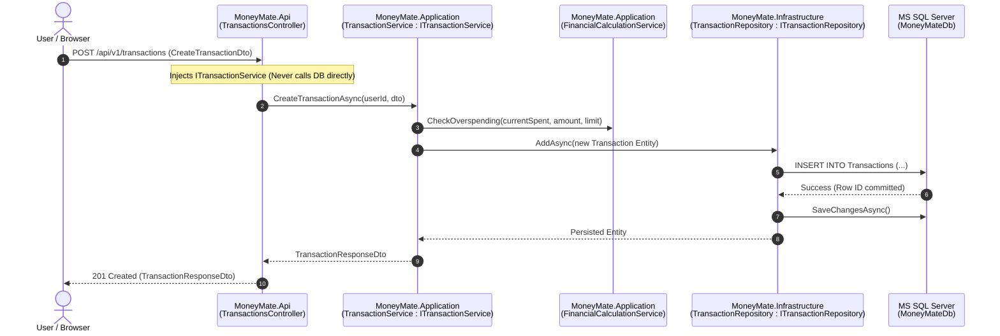

# 🪙 MoneyMate — .NET 9 Clean Architecture Specification & Engineering Blueprint

> **Official Architecture Document for MoneyMate Personal Finance Platform**  
> **Pattern Standard:** `Controller ➔ IService / Service ➔ IRepository / Repository ➔ Entity & DTO`  
> **Namespace & Project Prefix:** `MoneyMate.*`  
> **Framework:** .NET 9.0 LTS | Microsoft SQL Server LocalDB | React 19 + TypeScript  

---

## 🏗️ 1. Clean Architecture Design Principles

MoneyMate follows strict Uncle Bob Clean Architecture / Onion Architecture principles. The core domain is completely independent of external databases, frameworks, or user interfaces. Dependencies only point inward:

```
+-------------------------------------------------------------+
|                MoneyMate.Api (Controllers)                  |
|  - DashboardController      - TransactionsController        |
|  - SalaryProfileController  - AdvisorController             |
+------------------------------+------------------------------+
                               | Injects IServices
                               v
+-------------------------------------------------------------+
|               MoneyMate.Application (Core Logic)            |
|  - Interfaces (IServices)    - DTOs                         |
|  - Services Implementations  - FinancialCalculationService  |
+------------------------------+------------------------------+
                               | Injects IRepositories
                               v
+-------------------------------------------------------------+
|                 MoneyMate.Domain (Entities)                 |
|  - Entities (User, SalaryProfile, Category, Transaction)    |
|  - Interfaces (IRepositories contracts)                     |
+-------------------------------------------------------------+
                               ^ Implements IRepositories
                               |
+------------------------------+------------------------------+
|            MoneyMate.Infrastructure (Persistence)           |
|  - MoneyMateDbContext (EF Core SQL Server)                  |
|  - Repository<T> & Specific Repositories                    |
+-------------------------------------------------------------+
```

---

## 📁 2. Enterprise Folder Structure & Naming Conventions

All projects use the unified **`MoneyMate.*`** prefix:

```text
i:\Desktop\moneymate\
├── src\
│   ├── backend\
│   │   ├── MoneyMate.sln                                     # Solution root
│   │   │
│   │   ├── MoneyMate.Domain\                                 # LAYER 1: Core Domain (Zero External Dependencies)
│   │   │   ├── Entities\                                     # [entity] Domain Business Models
│   │   │   │   ├── User.cs                                   # Root user entity
│   │   │   │   ├── SalaryProfile.cs                          # Salary and pay cycle
│   │   │   │   ├── Category.cs                               # Budget allocation categories
│   │   │   │   ├── Transaction.cs                            # Outlays & expenses
│   │   │   │   ├── SavingsGoal.cs                            # Emergency fund commitment
│   │   │   │   └── Alert.cs                                  # Overspending & pace warnings
│   │   │   └── Interfaces\                                   # [irepo] Repository Contracts
│   │   │       ├── IRepository.cs                            # Generic IRepository<T>
│   │   │       ├── ITransactionRepository.cs                 # Transaction queries
│   │   │       ├── ISalaryProfileRepository.cs               # Salary profile queries
│   │   │       ├── ICategoryRepository.cs                    # Category queries
│   │   │       └── ISavingsGoalRepository.cs                 # Savings goal queries
│   │   │
│   │   ├── MoneyMate.Application\                            # LAYER 2: Application Use Cases & Business Rules
│   │   │   ├── DTOs\                                         # [dto] Data Transfer Objects
│   │   │   │   ├── DashboardDtos.cs                          # DashboardMetricsDto, CategoryStatusDto, AdvisorRecommendationDto
│   │   │   │   ├── TransactionDtos.cs                        # CreateTransactionDto, TransactionResponseDto
│   │   │   │   ├── SalaryDtos.cs                             # UpdateSalaryDto
│   │   │   │   └── AdvisorDtos.cs                            # AdvisorQueryRequestDto, AdvisorQueryResponseDto
│   │   │   ├── Interfaces\                                   # [iservise] Application Service Contracts
│   │   │   │   ├── IFinancialCalculationService.cs           # Deterministic math engine contract
│   │   │   │   ├── IDashboardService.cs                      # Dashboard orchestration contract
│   │   │   │   ├── ITransactionService.cs                    # Transaction workflow contract
│   │   │   │   ├── ISalaryProfileService.cs                  # Salary management contract
│   │   │   │   └── IAdvisorService.cs                        # Copilot advisory contract
│   │   │   └── Services\                                     # [servise] Concrete Service Implementations
│   │   │       ├── FinancialCalculationService.cs            # Deterministic math calculation engine
│   │   │       ├── DashboardService.cs                       # Dashboard aggregation service
│   │   │       ├── TransactionService.cs                     # Transaction lifecycle service
│   │   │       ├── SalaryProfileService.cs                   # Salary profile service
│   │   │       └── AdvisorService.cs                         # Side copilot query analyzer
│   │   │
│   │   ├── MoneyMate.Infrastructure\                         # LAYER 3: Data Access & External Infrastructure
│   │   │   ├── Persistence\                                  # Entity Framework Core 9 Context
│   │   │   │   └── MoneyMateDbContext.cs                     # Model builder, HasPrecision(18,2) & default seeds
│   │   │   └── Repositories\                                 # [repo] Concrete EF Core Repositories
│   │   │       ├── Repository.cs                             # Generic Repository<T> : IRepository<T>
│   │   │       ├── TransactionRepository.cs                  # TransactionRepository : ITransactionRepository
│   │   │       ├── SalaryProfileRepository.cs                # SalaryProfileRepository : ISalaryProfileRepository
│   │   │       ├── CategoryRepository.cs                     # CategoryRepository : ICategoryRepository
│   │   │       └── SavingsGoalRepository.cs                  # SavingsGoalRepository : ISavingsGoalRepository
│   │   │
│   │   └── MoneyMate.Api\                                    # LAYER 4: Web API & Presentation Entry Point
│   │       ├── Controllers\                                  # [contrler] RESTful API Controllers
│   │       │   ├── DashboardController.cs                    # Injects IDashboardService
│   │       │   ├── TransactionsController.cs                 # Injects ITransactionService
│   │       │   ├── SalaryProfileController.cs                # Injects ISalaryProfileService
│   │       │   └── AdvisorController.cs                      # Injects IAdvisorService
│   │       ├── appsettings.json                              # LocalDB connection string & CORS config
│   │       └── Program.cs                                    # IoC Container setup & pipeline initialization
│   │
│   └── frontend\                                             # React 19 + TypeScript SPA
│       ├── src\
│       │   ├── api\                                          # HTTP Clients
│       │   │   ├── moneyMateApi.ts                           # Typed fetch client to http://localhost:5000/api/v1
│       │   │   └── spendwiseApi.ts                           # Re-export bridge for backward-compatibility
│       │   ├── components\                                   # UI Modules
│       │   │   ├── common\                                   # Header, AlertBanners, SalaryModal
│       │   │   ├── dashboard\                                # SummaryCards, CategoryGrid, SavingsGoalCard
│       │   │   ├── advisor\                                  # SideAdvisor AI Copilot
│       │   │   ├── analytics\                                # Donut charts, burn curves & diagrams
│       │   │   └── transactions\                             # TransactionList, AddTransactionModal
│       │   ├── data\financialEngine.ts                       # Client-side deterministic fallback math
│       │   └── types\index.ts                                # TypeScript domain contracts
│       └── index.html                                        # HTML5 root with MoneyMate branding
│
└── tests\
    └── MoneyMate.UnitTests\                                  # Automated Unit Tests
        ├── MoneyMate.UnitTests.csproj
        └── FinancialCalculationServiceTests.cs               # xUnit tests for safe balance & overspending
```

---

## 🔄 3. Request-Response Lifecycle & Pattern Flow

When a user interacts with MoneyMate (e.g. logging an expense or consulting the AI Advisor):



---

## 🧩 4. Pattern Components Breakdown

### 1. `Entities` (`MoneyMate.Domain.Entities`)
Pure POCO classes representing database records and core state:
- **`User`**: Root profile entity (`Id`, `Email`, `FullName`, `CurrencyCode`).
- **`SalaryProfile`**: Salary amount (`MonthlyTakeHome`), `PaydayDayOfMonth`, `IsActive`.
- **`Category`**: Spending buckets (`Name`, `Icon`, `ColorHex`, `IsEssential`, `AllocatedAmount`).
- **`Transaction`**: Records of outlays (`Amount`, `CategoryId`, `TransactionType`, `PaymentMethod`, `Note`, `TransactionDate`).
- **`SavingsGoal`**: Emergency fund lock (`TargetAmount`, `CurrentAmount`, `MonthlyCommitment`).
- **`Alert`**: Active overspending warnings and pace notifications.

### 2. `IRepo` (`MoneyMate.Domain.Interfaces`)
Abstraction of data access decoupled from ORMs:
```csharp
public interface IRepository<T> where T : class
{
    Task<T?> GetByIdAsync(Guid id);
    Task<List<T>> GetAllAsync();
    Task<List<T>> FindAsync(Expression<Func<T, bool>> predicate);
    Task AddAsync(T entity);
    void Update(T entity);
    void Remove(T entity);
    Task SaveChangesAsync();
}
```

### 3. `Repo` (`MoneyMate.Infrastructure.Repositories`)
Concrete implementations using Entity Framework Core 9:
- Generic `Repository<T> : IRepository<T>` handles CRUD operations.
- Specialized repositories (`TransactionRepository`, `SalaryProfileRepository`, `CategoryRepository`, `SavingsGoalRepository`) implement domain-specific query optimizations.

### 4. `DTO` (`MoneyMate.Application.DTOs`)
Immutable records for crossing architectural boundaries without exposing database entities:
- **`DashboardResponseDto`**: Combined metrics, category statuses, alerts, and advisor recommendations.
- **`CreateTransactionDto`**: Input payload for expense creation.
- **`TransactionResponseDto`**: Output representation of persisted transactions.
- **`UpdateSalaryDto`**: Payday and salary adjustments.
- **`AdvisorQueryRequestDto`** / **`AdvisorQueryResponseDto`**: Conversational copilot query/response.

### 5. `IService` (`MoneyMate.Application.Interfaces`)
Contracts defining business orchestration:
- **`IDashboardService`**: Aggregates balances, pace calculations, alerts, and allocations.
- **`ITransactionService`**: Creates, lists, and deletes transactions.
- **`ISalaryProfileService`**: Manages user pay cycles and baseline take-home pay.
- **`IFinancialCalculationService`**: High-precision deterministic math calculations.
- **`IAdvisorService`**: Evaluates affordability queries against live safe balances.

### 6. `Service` (`MoneyMate.Application.Services`)
Implementations of business logic:
- Injects repositories (`IRepository`) and domain calculation services.
- Translates entities to DTOs.
- Enforces financial invariants (e.g., negative take-home validation, safe balance calculation).

### 7. `Controller` (`MoneyMate.Api.Controllers`)
Exposes HTTP REST endpoints:
- Injects `IService` interfaces via .NET 9 dependency injection.
- Formats HTTP status codes (`200 OK`, `201 Created`, `400 Bad Request`, `404 Not Found`).
- Does **not** contain SQL queries or business calculation math.

---

## 🧮 5. Pure Financial Calculation Engine

Calculations are deterministic to prevent calculation hallucinations:

$$\text{Current Cash Balance} = \text{Monthly Take-Home} - \sum \text{Expenses}$$

$$\text{Safe Available Balance} = \text{Current Cash Balance} - \text{Committed Savings}$$

$$\text{Safe Daily Pace} = \frac{\text{Safe Available Balance}}{\max(1, \text{Days Remaining in Cycle})}$$

All monetary columns use high-precision decimals in SQL Server:
```csharp
modelBuilder.Entity<SalaryProfile>().Property(s => s.MonthlyTakeHome).HasPrecision(18, 2);
modelBuilder.Entity<Category>().Property(c => c.AllocatedAmount).HasPrecision(18, 2);
modelBuilder.Entity<Transaction>().Property(t => t.Amount).HasPrecision(18, 2);
```

---

## ⚙️ 6. Verification and Test Results

### 1. Automated Unit Testing
Executed via `dotnet test`:
```text
Passed!  - Failed: 0, Passed: 3, Skipped: 0, Total: 3, Duration: 162 ms - MoneyMate.UnitTests.dll (net9.0)
```
- ✅ Verified ₹25,000 monthly take-home salary calculation with ₹5,000 committed savings shield.
- ✅ Verified overspending excess calculation.
- ✅ Verified safe pace burn rate.

### 2. Live API Health
- Backend listening on: `http://localhost:5000`
- Swagger UI available on: `http://localhost:5000/swagger`
- Real-time endpoints:
  - `GET /api/v1/dashboard/summary`
  - `GET /api/v1/transactions`
  - `POST /api/v1/transactions`
  - `PUT /api/v1/salary-profile`
  - `POST /api/v1/advisor/chat`

### 3. Frontend Integration
- React 19 Frontend running on: `http://localhost:5173`
- Connection status badge: `🟢 Connected to .NET 9 API & SQL Server`
- Verified live sync with Microsoft SQL Server LocalDB (`MoneyMateDb`).
