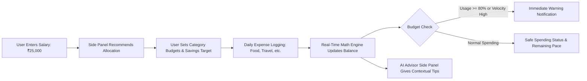
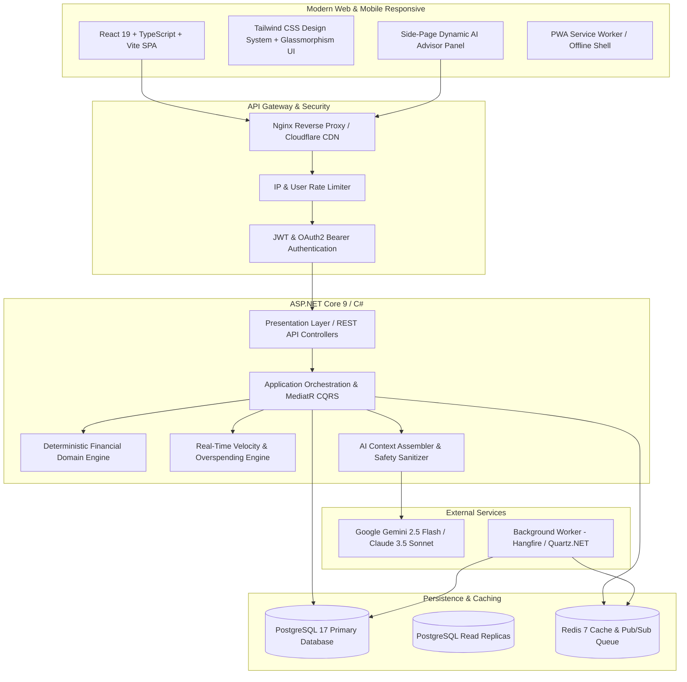
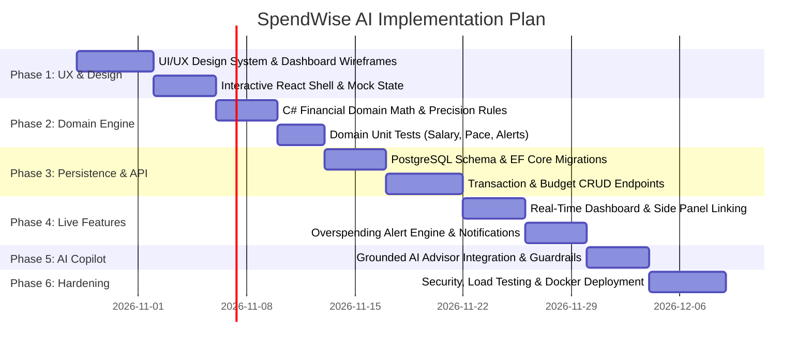

# MONEYMATE — Master Architecture & Implementation Plan
**Version:** 1.0.0 • **Status:** Approved Blueprint for Implementation • **Date:** October 2026  
**Target Audience:** Salaried Individuals, Engineering Pair-Programming, Production Scaling

---

## 1. Executive Summary & Product Vision

**MoneyMate** is a next-generation personal finance and salary intelligence platform designed to eliminate the anxiety of "where did my paycheck go?". 

Unlike traditional retrospective expense trackers that merely show graphs of money already lost, MoneyMate acts as a **proactive financial copilot**:
1. **Salary Ingestion & Rule-Based Allocation:** User defines their monthly take-home income (e.g., ₹25,000) and pay schedule.
2. **Contextual Side-Panel Advisor:** Simultaneously provides smart allocation guidance (e.g., Food ₹4,000, Travel ₹2,500, Family ₹5,000, Savings ₹5,000, Fixed Bills ₹6,000, Buffer ₹2,500).
3. **Frictionless Daily Expense Logging:** Every expense is logged with amount, category, payment mode, and note.
4. **Real-Time Mathematical Balance Tracking:** Immediate recalculation of remaining category limits and overall available safe-to-spend balance.
5. **Intelligent Overspending Prevention:** Proactive velocity and threshold alerts warn the user *before* or *at the moment* an expense threatens their monthly budget or savings goal.
6. **Zero-Hallucination AI Copilot:** Natural language explanations powered by LLMs (Gemini / Claude / OpenAI) strictly grounded on verified, backend-computed balance figures.

---

## 2. User Experience Flow & Core Use Case (₹25,000 Example)

### 2.1 The Core Persona Journey


### 2.2 Concrete Example Scenario
* **Monthly Salary:** ₹25,000 (Credited on 1st of month)
* **Savings Goal:** ₹5,000 / month (Building ₹60,000 Emergency Fund)
* **Fixed Commitments:** ₹6,000 (Rent & Electricity)
* **Variable Category Budgets:**
  * Food & Groceries: ₹4,000
  * Travel & Commute: ₹2,500
  * Family Support: ₹5,000
  * Personal & Misc: ₹2,500
* **Day-to-Day Flow:**
  * **Day 5:** User logs Food ₹500 (`Remaining Food: ₹3,500`, `Remaining Salary: ₹24,500`).
  * **Day 12:** User logs unexpected Family Expense ₹4,200. Family category hits 84% usage.
  * **System Trigger:** Alert banner appears: *"Warning: Family spending reached 84% (₹4,200/₹5,000) with 18 days remaining in the month."*
  * **Side Panel Copilot Suggestion:** *"You have ₹800 remaining in Family budget. To preserve your ₹5,000 savings goal, avoid additional discretionary outlays this week or adjust your ₹2,500 Personal buffer."*

---

## 3. Financial Domain Rules & Mathematical Engine

To ensure financial integrity, **all calculations are 100% deterministic** inside backend domain services using high-precision decimals. The AI never calculates balances; it only narrates verified facts.

### 3.1 Financial Definitions Matrix
| Metric | Mathematical Formula | Purpose in UI |
| :--- | :--- | :--- |
| **Total Income** ($I_{total}$) | $\sum \text{IncomeTransactions}_{\text{current\_period}}$ | Shows actual verified inflows. |
| **Total Expenses Paid** ($E_{paid}$) | $\sum \text{ExpenseTransactions}_{\text{current\_period}}$ | Total cash already spent. |
| **Committed Savings** ($S_{plan}$) | $\sum \text{ActiveSavingsGoalAllocations}$ | Locked reserve to prevent accidental spending. |
| **Upcoming Fixed Bills** ($B_{pending}$) | $\sum \text{UnpaidBills}_{\text{due\_in\_period}}$ | Future obligations due before next salary. |
| **Current Cash Balance** ($B_{cash}$) | $\text{OpeningBalance} + I_{total} - E_{paid}$ | Actual cash in wallet/bank right now. |
| **Safe Available Balance** ($B_{safe}$) | $B_{cash} - S_{plan} - B_{pending}$ | Real spending power remaining without defaulting. |
| **Category Remaining** ($C_{rem}$) | $\text{CategoryBudget} - \sum \text{CategoryExpenses}$ | Amount left for specific category this month. |
| **Spending Velocity / Pace** ($V_{pace}$) | $\frac{\text{SpentDays}}{\text{TotalDaysInMonth}} \times \text{CategoryBudget}$ | Expected spend vs. actual spend at current day. |

### 3.2 Overspending Detection Logic
* **Soft Warning:** Category spend reaches **80%** before 75% of the month has elapsed.
* **Hard Warning:** Category spend reaches **100%** (exceeds budget).
* **Deficit Alert:** Total projected expenses ($E_{paid} + B_{pending} + S_{plan}$) exceed Total Income ($I_{total}$).

---

## 4. Scalable System Architecture Design

The platform uses a **Modular Clean Architecture (Monolith-First, Microservice-Ready)** designed to scale from 1 user to 1,000,000+ users seamlessly.



---

## 5. Technology Stack Selection & Rationale

| Layer | Chosen Technology | Why This Tech? (Scalability & Maintainability) |
| :--- | :--- | :--- |
| **Frontend Framework** | **React 19 + TypeScript + Vite** | Blazing fast HMR, strict type safety, zero compile bloat, rich ecosystem for data visualizations (Recharts / Chart.js). |
| **Styling & Design** | **Tailwind CSS + Custom CSS Variables** | Bespoke dark/light glassmorphic UI, modern typography (Inter/Outfit), fluid micro-animations without heavy component library overhead. |
| **State Management** | **Zustand + TanStack Query v5** | Server-state caching, automatic optimistic UI updates when adding expenses, zero boilerplate. |
| **Backend Core** | **ASP.NET Core 9 Web API (C#)** | Industry benchmark execution speed, native high-precision `decimal` financial arithmetic, clean dependency injection, enterprise-grade testability. *(Alternative: Node.js NestJS or Python FastAPI, but C# offers unmatched mathematical safety and throughput).* |
| **ORM & Data Access** | **Entity Framework Core 9 + Dapper** | EF Core for maintainable domain mappings & migrations; Dapper for high-throughput dashboard aggregation queries. |
| **Primary Database** | **PostgreSQL 17** | ACID compliant, high-concurrency connection pooling via PgBouncer, JSONB support for alert metadata, table partitioning for transactions. |
| **Cache & Queue** | **Redis 7** | Sub-5ms response for dashboard summaries, sliding-window rate limiting, and pub/sub for instant alert pushes. |
| **Background Jobs** | **Hangfire / Quartz.NET** | Scheduled salary-cycle rollovers, monthly recap generation, automated bill reminders. |
| **AI Orchestration** | **Backend LLM Service (Gemini 2.5 Flash API)** | Low latency (<500ms), structured JSON schema outputs, lowest cost-to-performance ratio for real-time advice. |
| **DevOps & Containers**| **Docker + Docker Compose + GitHub Actions** | 100% reproducible local and cloud staging environments. |

---

## 6. Comprehensive Database Schema (PostgreSQL DDL)

### 6.1 Entity-Relationship Diagram (Textual Representation)
* **Users** `1:N` **SalaryProfiles** (history of salary changes)
* **Users** `1:N` **Categories** (system default + user customized)
* **Users** `1:N` **Transactions** (income and expenses)
* **Users** `1:N` **MonthlyBudgets** `1:N` **CategoryBudgets**
* **Users** `1:N` **SavingsGoals** `1:N` **SavingsContributions**
* **Users** `1:N` **Alerts** (unread / acknowledged notifications)
* **Users** `1:N` **AdvisorSessions** `1:N` **AdvisorMessages**

### 6.2 Key Tables Definition
```sql
-- 1. Users & Profiles
CREATE TABLE users (
    id UUID PRIMARY KEY DEFAULT gen_random_uuid(),
    email VARCHAR(255) UNIQUE NOT NULL,
    password_hash VARCHAR(255) NOT NULL,
    full_name VARCHAR(100) NOT NULL,
    currency_code VARCHAR(3) DEFAULT 'INR', -- ₹ Default
    created_at TIMESTAMPTZ DEFAULT NOW(),
    updated_at TIMESTAMPTZ DEFAULT NOW()
);

-- 2. Salary Profile
CREATE TABLE salary_profiles (
    id UUID PRIMARY KEY DEFAULT gen_random_uuid(),
    user_id UUID NOT NULL REFERENCES users(id) ON DELETE CASCADE,
    monthly_take_home NUMERIC(12, 2) NOT NULL CHECK (monthly_take_home > 0),
    payday_day_of_month SMALLINT NOT NULL CHECK (payday_day_of_month BETWEEN 1 AND 31),
    effective_from_date DATE NOT NULL,
    is_active BOOLEAN DEFAULT TRUE,
    created_at TIMESTAMPTZ DEFAULT NOW()
);
CREATE INDEX idx_salary_user ON salary_profiles(user_id, is_active);

-- 3. Categories (Default & Custom)
CREATE TABLE categories (
    id UUID PRIMARY KEY DEFAULT gen_random_uuid(),
    user_id UUID REFERENCES users(id) ON DELETE CASCADE, -- NULL means System Default
    name VARCHAR(50) NOT NULL,
    icon VARCHAR(50) NOT NULL,
    color_hex VARCHAR(7) NOT NULL,
    is_default BOOLEAN DEFAULT FALSE,
    is_income BOOLEAN DEFAULT FALSE,
    created_at TIMESTAMPTZ DEFAULT NOW()
);

-- 4. Monthly Budgets & Category Allocations
CREATE TABLE monthly_budgets (
    id UUID PRIMARY KEY DEFAULT gen_random_uuid(),
    user_id UUID NOT NULL REFERENCES users(id) ON DELETE CASCADE,
    year_month VARCHAR(7) NOT NULL, -- Format: '2026-10'
    total_budget_limit NUMERIC(12, 2) NOT NULL,
    created_at TIMESTAMPTZ DEFAULT NOW(),
    UNIQUE(user_id, year_month)
);

CREATE TABLE category_budgets (
    id UUID PRIMARY KEY DEFAULT gen_random_uuid(),
    monthly_budget_id UUID NOT NULL REFERENCES monthly_budgets(id) ON DELETE CASCADE,
    category_id UUID NOT NULL REFERENCES categories(id) ON DELETE RESTRICT,
    allocated_amount NUMERIC(12, 2) NOT NULL CHECK (allocated_amount >= 0),
    warning_threshold_pct SMALLINT DEFAULT 80 CHECK (warning_threshold_pct BETWEEN 10 AND 100),
    UNIQUE(monthly_budget_id, category_id)
);

-- 5. Transactions (Income, Expense, Transfer)
CREATE TABLE transactions (
    id UUID PRIMARY KEY DEFAULT gen_random_uuid(),
    user_id UUID NOT NULL REFERENCES users(id) ON DELETE CASCADE,
    category_id UUID NOT NULL REFERENCES categories(id) ON DELETE RESTRICT,
    amount NUMERIC(12, 2) NOT NULL CHECK (amount > 0),
    transaction_type VARCHAR(10) NOT NULL CHECK (transaction_type IN ('EXPENSE', 'INCOME', 'SAVING')),
    transaction_date DATE NOT NULL,
    payment_method VARCHAR(30) DEFAULT 'UPI', -- UPI, Cash, Bank, Credit Card
    note TEXT,
    is_recurring BOOLEAN DEFAULT FALSE,
    created_at TIMESTAMPTZ DEFAULT NOW(),
    updated_at TIMESTAMPTZ DEFAULT NOW()
);
CREATE INDEX idx_tx_user_date ON transactions(user_id, transaction_date DESC);
CREATE INDEX idx_tx_category ON transactions(category_id);

-- 6. Savings Goals
CREATE TABLE savings_goals (
    id UUID PRIMARY KEY DEFAULT gen_random_uuid(),
    user_id UUID NOT NULL REFERENCES users(id) ON DELETE CASCADE,
    title VARCHAR(100) NOT NULL,
    target_amount NUMERIC(12, 2) NOT NULL CHECK (target_amount > 0),
    current_amount NUMERIC(12, 2) DEFAULT 0 CHECK (current_amount >= 0),
    target_date DATE NOT NULL,
    monthly_commitment NUMERIC(12, 2) NOT NULL DEFAULT 0,
    is_achieved BOOLEAN DEFAULT FALSE,
    created_at TIMESTAMPTZ DEFAULT NOW()
);

-- 7. Intelligent Alerts & Overspending Warnings
CREATE TABLE alerts (
    id UUID PRIMARY KEY DEFAULT gen_random_uuid(),
    user_id UUID NOT NULL REFERENCES users(id) ON DELETE CASCADE,
    category_id UUID REFERENCES categories(id) ON DELETE SET NULL,
    alert_type VARCHAR(30) NOT NULL, -- 'THRESHOLD_80', 'THRESHOLD_EXCEEDED', 'VELOCITY_HIGH'
    severity VARCHAR(15) NOT NULL, -- 'INFO', 'WARNING', 'CRITICAL'
    title VARCHAR(150) NOT NULL,
    message TEXT NOT NULL,
    is_read BOOLEAN DEFAULT FALSE,
    created_at TIMESTAMPTZ DEFAULT NOW()
);
CREATE INDEX idx_alerts_user_unread ON alerts(user_id, is_read) WHERE is_read = FALSE;
```

---

## 7. RESTful API Endpoints & Request/Response Contracts

All API endpoints are strictly versioned (`/api/v1/`), authorized via Bearer JWT, and enforce multi-tenant owner checks.

### 7.1 Core API Routes
| Method | Endpoint | Description |
| :--- | :--- | :--- |
| `POST` | `/api/v1/auth/register` | Register new user account. |
| `POST` | `/api/v1/auth/login` | Authenticate and receive JWT + Refresh Token. |
| `GET` | `/api/v1/salary-profile` | Get active salary profile and historical details. |
| `PUT` | `/api/v1/salary-profile` | Update take-home salary, payday, and allocation rules. |
| `GET` | `/api/v1/dashboard/summary` | **Master endpoint:** Returns income, spent, available balance, category progress, active alerts, and side advice. |
| `GET` | `/api/v1/transactions` | Filterable list of transactions (by month, category, type). |
| `POST` | `/api/v1/transactions` | Create new transaction (instant recalculation trigger). |
| `PUT` | `/api/v1/transactions/{id}` | Edit an existing transaction. |
| `DELETE` | `/api/v1/transactions/{id}` | Delete transaction (reverses balance impact). |
| `GET` | `/api/v1/budgets/current` | Get current month's budget allocations and utilization. |
| `PUT` | `/api/v1/budgets/categories` | Update category allocations (e.g. adjust Food/Travel). |
| `GET` | `/api/v1/savings-goals` | List all savings goals with progress and remaining months. |
| `POST` | `/api/v1/savings-goals` | Create a new savings goal. |
| `GET` | `/api/v1/alerts` | Get active warning and notification stream. |
| `PATCH` | `/api/v1/alerts/{id}/read` | Mark alert as acknowledged. |
| `POST` | `/api/v1/advisor/chat` | Contextual side-panel conversation with AI. |

### 7.2 Master Dashboard Summary Contract (`GET /api/v1/dashboard/summary`)
```json
{
  "period": "2026-10",
  "currency": "INR",
  "summary": {
    "totalSalaryIncome": 25000.00,
    "totalExpensesPaid": 12700.00,
    "committedSavings": 5000.00,
    "currentCashBalance": 12300.00,
    "safeAvailableBalance": 7300.00,
    "burnRatePerDay": 470.37,
    "daysRemainingInCycle": 15
  },
  "categoryBreakdown": [
    {
      "categoryId": "c1",
      "categoryName": "Food & Groceries",
      "allocated": 4000.00,
      "spent": 3350.00,
      "remaining": 650.00,
      "percentageUsed": 83.75,
      "status": "WARNING"
    },
    {
      "categoryId": "c2",
      "categoryName": "Travel & Commute",
      "allocated": 2500.00,
      "spent": 1100.00,
      "remaining": 1400.00,
      "percentageUsed": 44.0,
      "status": "HEALTHY"
    },
    {
      "categoryId": "c3",
      "categoryName": "Family Support",
      "allocated": 5000.00,
      "spent": 5000.00,
      "remaining": 0.00,
      "percentageUsed": 100.0,
      "status": "EXCEEDED"
    }
  ],
  "recentAlerts": [
    {
      "id": "a1",
      "severity": "CRITICAL",
      "title": "Family Budget Exhausted",
      "message": "You have spent 100% of your ₹5,000 Family budget for this month."
    },
    {
      "id": "a2",
      "severity": "WARNING",
      "title": "Food Spending Pace Alert",
      "message": "Food is at 83.7% with 15 days remaining. Recommended daily limit: ₹43/day."
    }
  ],
  "sideAdvisorRecommendation": {
    "status": "CAUTION",
    "headline": "Watch Discretionary Spending to Protect Your ₹5,000 Savings Goal",
    "adviceParagraph": "Your fixed family obligations and food spending have used 67% of total monthly spending. You have ₹7,300 safe spending balance left. To keep your ₹5,000 emergency fund goal on track, cap daily non-essential purchases to under ₹250 for the next 10 days."
  }
}
```

---

## 8. AI Advisor Grounding & Safeguard Pipeline

To eliminate financial hallucination, the backend acts as a strict **Deterministic Grounding Filter** before invoking the LLM:

```
[User Chat Request] 
       ↓
[Extract Authenticated User ID]
       ↓
[Fetch Authoritative Numbers from Domain Service (No SQL generation by AI!)]
       ↓
[Assemble Compact Verified Context JSON]
       ↓
[Prompt Gateway with Rigid System Persona & Anti-Hallucination Guardrails]
       ↓
[LLM Generates Empathetic, Clear Explanation]
       ↓
[Response Validator: Checks for Unsupported Numbers]
       ↓
[Deliver to Side-Panel UI]
```

### 8.1 System Prompt Architecture
```text
You are SpendWise AI, an expert, encouraging, and mathematically accurate financial copilot.
CRITICAL RULES:
1. ONLY use the verified figures provided in the CONTEXT JSON. NEVER invent, assume, or alter balances, spent amounts, or salary totals.
2. If the user asks whether they can afford a purchase:
   - Compare purchase price against 'safeAvailableBalance' (NOT currentCashBalance).
   - If safeAvailableBalance < purchase price, explain why it jeopardizes their savings goal or upcoming commitments.
3. Suggest practical trade-offs (e.g., reallocating from unspent categories).
4. Tone: Non-judgmental, constructive, clear, and focused on empowering the user.
```

---

## 9. Scalability, High Availability & Security Strategy

### 9.1 Multi-Tenant Data Isolation
* Every database query incorporates tenant isolation (`WHERE user_id = @currentUserId`).
* Route IDs (e.g. `/transactions/{id}`) are verified against `user_id` ownership before updating or deleting.
* Automated integration tests verify that User A cannot read or mutate User B's records.

### 9.2 High-Throughput Performance (<50ms Dashboard Loads)
1. **Redis Read-Through Caching:** Master dashboard summary is cached in Redis with key `dash:{userId}:{yearMonth}` with a 10-minute TTL. Any transaction creation, edit, or deletion invalidates this cache tag immediately.
2. **Database Indexing:** Compound indexes on `(user_id, transaction_date DESC)` ensure lightning-fast retrieval of current month transactions even with 10M+ rows.
3. **Optimistic Concurrency:** Version stamps on budget and savings goal entities prevent race conditions on simultaneous mobile/web updates.

---

## 10. Phased Implementation Roadmap (Step-by-Step)



### Phase Details:
* **Phase 1 (UX & Design System):** Premium modern responsive UI with dark/light themes, sleek glassmorphism, responsive sidebar, side advisory panel, dynamic charts, and quick-add floating transaction modal.
* **Phase 2 (Domain Math Engine):** Pure, testable calculation library for Safe Balance, Burn Rate, Category Utilization, and Overspending Velocity.
* **Phase 3 (Persistence & REST API):** Database migrations, secure JWT authentication, and high-performance API endpoints.
* **Phase 4 (Live Integration):** Connect React UI with backend API; live auto-recalculation upon expense logging.
* **Phase 5 (Alert Engine & AI Copilot):** Real-time threshold notifications and side-page grounded AI advisor.
* **Phase 6 (Hardening & Deployment):** End-to-end testing, Docker containerization, and production deployment guide.

---

## 11. Definition of Ready (Next Immediate Step)

With this plan approved, the immediate next action is:
1. **Initialize the project repository structure** (`src/frontend` and `src/backend`).
2. **Build the high-fidelity UI dashboard prototype** with the ₹25,000 salary scenario, category breakdown, side advisor panel, and transaction logging modal.
3. **Implement the deterministic financial domain calculation tests.**
