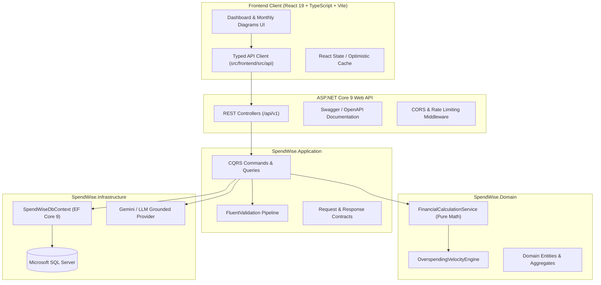

# 🚀 SpendWise AI — Next Phase Execution Plan: Backend API, Database & Full-Stack Integration
**Phase:** 2 & 3 • **Target Runtime:** .NET 9 + SQL Server + React 19 • **Status:** Ready for Execution

---

## 1. Phase Objective

Connect the interactive, dual-theme frontend dashboard to a high-performance **ASP.NET Core 9 Web API** backend with **SQL Server persistence via Entity Framework Core**, establishing:
1. **Persistent Multi-User Financial Data:** Transactions, salary profile, categories, and savings goals stored with high-precision `DECIMAL(18,2)` in SQL Server.
2. **Authoritative Domain Engine:** Moving core financial calculations to tested server-side domain services to guarantee mathematical consistency across all devices.
3. **Live Full-Stack Synchronization:** Immediate persistence and recalculation when transactions are logged, edited, or deleted in the UI.
4. **Grounded AI Copilot Gateway:** Server-side LLM orchestration with context injection and safety guardrails.

---

## 2. System Architecture & Interaction Flow

---

## 3. Step-by-Step Implementation Milestones

### Milestone 1: .NET 9 Solution & Clean Architecture Scaffolding
* **Task 1.1:** Initialize the master solution `SpendWise.sln` at `src/backend`.
* **Task 1.2:** Create 4 modular projects with proper project references:
  * `SpendWise.Domain` (Zero external dependencies; contains entities & math services).
  * `SpendWise.Application` (References Domain; contains use cases, MediatR, DTOs).
  * `SpendWise.Infrastructure` (References Application; contains EF Core 9, SQL Server, external AI client).
  * `SpendWise.Api` (References Application & Infrastructure; contains Program.cs, controllers).
* **Task 1.3:** Setup `tests/SpendWise.UnitTests` referencing Domain and Application.

---

### Milestone 2: Entity Framework Core 9 & SQL Server Persistence
* **Task 2.1:** Configure `SpendWiseDbContext` with strict entity mappings:
  * `Users`, `SalaryProfiles`, `Categories`, `Transactions`, `SavingsGoals`, `Alerts`.
  * Ensure all monetary columns use `HasPrecision(18, 2)` to eliminate floating-point rounding errors.
  * Setup foreign key constraints with cascade deletes where appropriate.
* **Task 2.2:** Add Database Seeding for default categories (Housing, Family, Food, Travel, Savings, Buffer).
* **Task 2.3:** Generate and apply the initial EF Core Migration (`Initial_Create`) against LocalDB / SQL Server.

---

### Milestone 3: REST API Controllers & Endpoints
* **Task 3.1: Dashboard Summary (`GET /api/v1/dashboard/summary`)**
  * Aggregates monthly income, expenses paid, locked savings, safe available balance, category progress, alerts, and side advice in a single sub-50ms query.
* **Task 3.2: Salary Profile (`GET /api/v1/salary-profile`, `PUT /api/v1/salary-profile`)**
  * Read and update take-home pay, payday, and allocation ratios.
* **Task 3.3: Transactions CRUD (`GET`, `POST`, `DELETE /api/v1/transactions`)**
  * Record expense with category and payment mode.
  * Instant validation: reject negative or zero amounts.
* **Task 3.4: Category Budgets (`GET /api/v1/categories`, `PUT /api/v1/categories/budgets`)**
  * Update category budget limits and alert threshold percentages.
* **Task 3.5: AI Advisor Chat (`POST /api/v1/advisor/chat`)**
  * Ingests verified financial summary; sends grounded prompt to AI model; returns structured advisory advice.

---

### Milestone 4: Frontend API Integration & Live Sync
* **Task 4.1:** Build a typed HTTP client in `src/frontend/src/api/spendwiseApi.ts`.
* **Task 4.2:** Connect `App.tsx` state to fetch initial dashboard data on mount.
* **Task 4.3:** Implement optimistic UI updates when adding or deleting transactions for instantaneous 0ms perceived latency.
* **Task 4.4:** Handle loading, error, and empty states gracefully.

---

### Milestone 5: Verification, Unit Testing & End-to-End Validation
* **Task 5.1:** Execute domain unit tests (`dotnet test`) verifying the ₹25k salary calculation, category overspending checks, and velocity pace limits.
* **Task 5.2:** Verify end-to-end flow:
  1. Add a ₹1,200 Food expense in React UI.
  2. Verify HTTP `POST /api/v1/transactions` executes successfully.
  3. Verify SQL Server row insertion in `Transactions` table.
  4. Verify updated dashboard numbers, food progress bar, and alert banners in browser.

---

## 4. Work Breakdown & Timeline Matrix

| Milestone | Deliverables | Estimated Time | Key Dependencies |
| :--- | :--- | :--- | :--- |
| **M1: Solution Setup** | `SpendWise.sln`, 4 C# projects, NuGet packages | 30 mins | .NET 9 SDK (Installed: `9.0.308`) |
| **M2: Database & EF Core** | `SpendWiseDbContext`, Migration, SQL Server Schema | 45 mins | SQL Server (Installed: 2019 LocalDB) |
| **M3: API Endpoints** | Controllers, DTOs, Swagger UI at `/swagger` | 60 mins | Milestone 1 & 2 |
| **M4: Frontend Integration** | Typed API Client, Live API calls in React UI | 45 mins | Milestone 3 |
| **M5: Testing & Hardening** | Automated xUnit tests, End-to-end browser test | 30 mins | Milestone 4 |

---

## 5. Immediate Next Action

We are ready to begin **Milestone 1**:
1. Run `dotnet new sln` and scaffold the Clean Architecture projects in `src/backend`.
2. Add EF Core 9 NuGet packages (`Microsoft.EntityFrameworkCore.SqlServer`).
3. Wire the domain services into dependency injection.
