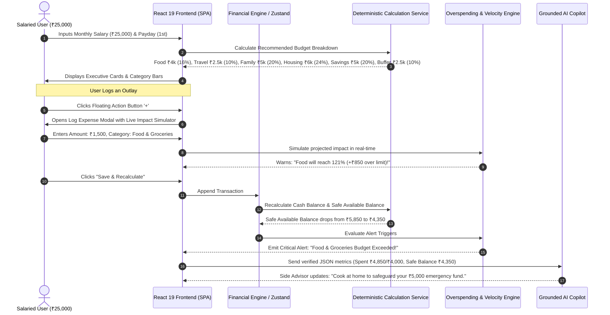
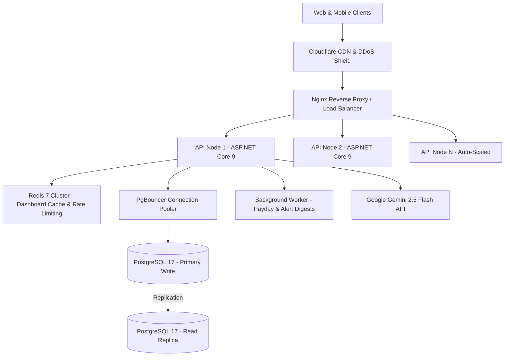

# 📘 SpendWise AI (MoneyMate) — Complete System Workflow & Architecture Manual
**Document Version:** 2.0.0 • **Classification:** Production Architecture & Workflow Guide • **Date:** October 2026

---

## 1. End-to-End System Workflow

SpendWise AI bridges deterministic accounting mathematics with context-aware AI advisory. The system operates on a zero-hallucination principle: **Domain logic computes; AI explains.**



---

## 2. The Complete Scenario Lifecycle (₹25,000 Salary Example)

### 2.1 Starting State (Day 1 of Month)
* **Monthly Take-Home Salary:** ₹25,000
* **Committed Savings Target:** ₹5,000 (Locked into Emergency Fund)
* **Budget Allocations:**
  * Housing & Rent: ₹6,000
  * Family Support: ₹5,000
  * Food & Groceries: ₹4,000
  * Travel & Commute: ₹2,500
  * Personal & Buffer: ₹2,500
* **Initial Balances:**
  * $\text{Current Cash Balance} = ₹25,000$
  * $\text{Safe Available Balance} = ₹25,000 - ₹5,000 = ₹20,000$
  * $\text{Safe Daily Pace} = \frac{₹20,000}{30 \text{ days}} = ₹666/\text{day}$

---

### 2.2 Mid-Month State (Day 16)
By Day 16, recurring bills and daily expenses have occurred:
* Rent Paid: ₹6,000
* Family Support: ₹4,200 (84% of ₹5,000)
* Food & Groceries: ₹3,350 (83.8% of ₹4,000)
* Travel & Commute: ₹600 (24% of ₹2,500)
* **Total Spent:** ₹14,150
* **Calculations:**
  $$\text{Current Cash Balance} = ₹25,000 - ₹14,150 = ₹10,850$$
  $$\text{Safe Available Balance} = ₹10,850 - ₹5,000 (\text{Locked Savings}) = ₹5,850$$
  $$\text{Days Remaining} = 31 - 16 = 15 \text{ days}$$
  $$\text{Safe Daily Pace} = \frac{₹5,850}{15} = ₹390/\text{day}$$

---

### 2.3 Real-Time Overspending Warning Trigger
When an expense pushes a category spend $\ge 80\%$ with more than 7 days remaining:
1. **Pace Alert Trigger:** Food reaches 83.8% on Day 16. The expected spend at mid-month is 50%. The system immediately flags a **High Velocity Warning**.
2. **Safe Allowance Re-computation:** The safe daily allowance for food drops to:
   $$\text{Daily Food Allowance} = \frac{₹650 \text{ remaining}}{15 \text{ days}} = ₹43/\text{day}$$
3. **Deficit Protection:** If total expenses exceed $₹20,000$, safe available balance becomes negative, signaling that the user is now depleting their ₹5,000 savings reserve.

---

## 3. Modular Folder Structure & Technical Hierarchy

The codebase is organized into a clean multi-tier structure:

```text
i:\Desktop\moneymate\
├── docs/                                    # Architecture, ADRs & Workflow manuals
│   ├── SPENDWISE_MASTER_PLAN_AND_ARCHITECTURE.md
│   └── SYSTEM_WORKFLOW_AND_ARCHITECTURE.md
│
├── src/
│   ├── frontend/                            # React 19 Client SPA
│   │   ├── src/
│   │   │   ├── components/                  # Feature-grouped presentation layer
│   │   │   │   ├── common/                  # Reusable layout & global dialogs
│   │   │   │   │   ├── Header.tsx           # Nav tabs, theme switcher, salary badge
│   │   │   │   │   ├── AlertBanners.tsx     # Compact expandable alert notifications
│   │   │   │   │   └── SalaryModal.tsx      # Salary profile adjustment dialog
│   │   │   │   ├── dashboard/               # Executive dashboard views
│   │   │   │   │   ├── SummaryCards.tsx     # 5 Executive metrics (Inflow, Spent, Savings, Safe Balance, Pace)
│   │   │   │   │   ├── CategoryGrid.tsx     # Category cards with progress bars & status badges
│   │   │   │   │   └── SavingsGoalCard.tsx  # Emergency fund milestone progress
│   │   │   │   ├── advisor/                 # Contextual Copilot
│   │   │   │   │   └── SideAdvisor.tsx      # Health score, target ratio breakdown & grounded Q&A
│   │   │   │   ├── analytics/               # Visual analytics page
│   │   │   │   │   └── AnalyticsPage.tsx    # Donut chart, 30-day burn curve, comparison bars & 50/30/20
│   │   │   │   ├── transactions/            # Ledger & form operations
│   │   │   │   │   ├── TransactionList.tsx  # Searchable & category-filtered transaction table
│   │   │   │   │   └── AddTransactionModal.tsx # Form with real-time impact simulation
│   │   │   │   └── index.ts                 # Central component barrel export
│   │   │   ├── data/
│   │   │   │   └── financialEngine.ts       # Mathematical calculation rules & advisory generator
│   │   │   ├── types/
│   │   │   │   └── index.ts                 # Master TypeScript interfaces
│   │   │   ├── App.tsx                      # Root state orchestrator & navigation manager
│   │   │   ├── index.css                    # Dual-theme design system (Dark Obsidian & Light Crystal)
│   │   │   └── main.tsx                     # Vite mounting entrypoint
│   │   ├── package.json
│   │   ├── tsconfig.json
│   │   └── vite.config.ts
│   │
│   └── backend/                             # Modular Clean Architecture (C# / .NET 9)
│       ├── SpendWise.Domain/                # Pure business logic & entities
│       │   ├── Entities/FinancialEntities.cs # User, Salary, Category, Transaction, Alert
│       │   └── Services/FinancialCalculationService.cs # Pure math algorithms
│       ├── SpendWise.Application/           # Use cases & CQRS pipeline
│       ├── SpendWise.Infrastructure/        # EF Core, PostgreSQL & AI provider integration
│       └── SpendWise.Api/                   # Controllers & JWT authentication
│
├── tests/
│   └── SpendWise.UnitTests/
│       └── FinancialCalculationServiceTests.cs # Automated xUnit tests for math rules
│
└── package.json                             # Root script dispatcher
```

---

## 4. Dual-Theme Architecture & Design Tokens

Theme selection is driven by the `data-theme` attribute on the root HTML element (`[data-theme="dark"]` and `[data-theme="light"]`).

### Theme Token Mapping
| Token | Dark Obsidian Luxe | Light Crystal |
| :--- | :--- | :--- |
| `--bg-base` | `#060913` (Deep midnight) | `#f4f6fb` (Crisp pearl) |
| `--bg-card` | `rgba(14, 21, 37, 0.75)` | `rgba(255, 255, 255, 0.88)` |
| `--text-main` | `#f8fafc` (High contrast white) | `#1e293b` (Deep slate) |
| `--emerald-main` | `#10b981` (Vibrant emerald) | `#059669` (Rich emerald) |
| `--indigo-main` | `#6366f1` (Electric violet) | `#4f46e5` (Royal indigo) |
| `--rose-main` | `#f43f5e` (Crimson rose) | `#e11d48` (Vibrant rose) |
| `--shadow-glass` | `0 16px 40px -10px rgba(0,0,0,0.55)` | `0 16px 36px -8px rgba(15,23,42,0.08)` |

---

## 5. Visual Diagrams in the Analytics Module

The **Monthly Diagrams** view (`#tab-analytics`) incorporates four complementary financial visualizations:

1. **Expense Category Distribution (Donut Chart):**
   - SVG vector ring computing arc segments via `stroke-dasharray` and `stroke-dashoffset`.
   - Hovering over any slice or legend item highlights the category, spent amount, and proportional percentage.
2. **30-Day Cumulative Spending Curve vs. Ideal Budget Pace:**
   - Plots actual cumulative expenses against a linear target trajectory line ending at $\text{Salary} - \text{Savings}$.
   - Shows at a glance whether the current burn rate is above or below safe trajectory.
3. **Category Budget Allocation vs. Actual Spending (Horizontal Comparison Bars):**
   - Displays allocated limit vs. actual spend with explicit delta annotations (`-₹200 Left` or `+₹850 Over`).
4. **50 / 30 / 20 Financial Health Rule Breakdown:**
   - Automatically classifies categories into **Essential Needs** (50%), **Discretionary Wants** (30%), and **Savings** (20%).
   - Displays compliance indicators to guide sustainable personal financial habits.

---

## 6. Grounded AI Advisor Integration & Guardrails

To prevent financial hallucinations, the backend acts as a strict **Deterministic Grounding Filter** before invoking the LLM:

```
[User Query: "Can I spend ₹2,000 on shoes?"]
       ↓
[Authenticated User Identification]
       ↓
[Fetch Authoritative Numbers from Calculation Engine]
  - Total Income: ₹25,000
  - Safe Available Balance: ₹5,850
  - Committed Savings: ₹5,000
  - Personal Buffer Remaining: ₹2,500
  - Days Remaining: 15
       ↓
[Assemble Compact JSON Context Payload]
       ↓
[LLM Evaluates Grounded Facts (No Math Calculation in Prompt)]
       ↓
[Response Delivered: "✅ Feasible: You have ₹5,850 safe balance. Spending ₹2,000 leaves ₹3,850 (₹256/day). Your ₹5,000 savings remain 100% protected."]
```

---

## 7. Scalability Architecture for 1,000,000+ Concurrent Users

To support massive scaling without latency degradation:



### Key Scaling Pillars:
1. **Sub-50ms Master Dashboard:** Read-through caching in Redis using cache key `dash:{userId}:{yearMonth}` with instant invalidation upon transaction mutations.
2. **PostgreSQL Partitioning:** Range-partitioning on `transactions` table by `transaction_date` (monthly partitions) ensures instant index lookups even across 100M+ historical rows.
3. **Optimistic Concurrency:** Row versioning on budget entities avoids race conditions when multiple devices log expenses simultaneously.
4. **Decoupled Asynchronous Alerts:** High-volume velocity and threshold alert evaluations can be offloaded to Redis Pub/Sub workers for zero impact on API latency.

---

## 8. Summary of Engineering Commands

| Command | Working Directory | Description |
| :--- | :--- | :--- |
| `npm run dev` | `i:\Desktop\moneymate` | Starts Vite development server at `http://localhost:5173`. |
| `npm run build` | `i:\Desktop\moneymate` | Typechecks TypeScript and compiles production bundle to `dist/`. |
| `npm run preview` | `i:\Desktop\moneymate` | Previews the optimized production bundle locally. |
| `dotnet test` | `i:\Desktop\moneymate\tests` | Executes xUnit automated tests for backend calculation services. |
